# NT Tech Innovation — User Manual

A step-by-step guide to the NT Tech Innovation website and its team dashboard (CRM). It's written for beginners: no coding knowledge is needed to follow Parts 2–4.

> This is a concept project. The company content, people and projects shown are demo data.

## Contents

1. [Getting started (running the app)](#1-getting-started)
2. [The public website](#2-the-public-website)
   - [Home page](#21-home-page)
   - [Services, Work and About pages](#22-services-work-and-about)
   - [Chatting with Nixo](#23-chatting-with-nixo)
   - [Getting a quote](#24-getting-a-quote)
   - [Using it on a phone](#25-on-a-phone)
3. [The team dashboard](#3-the-team-dashboard)
   - [Logging in](#31-logging-in)
   - [Dashboard](#32-dashboard)
   - [Leads list and board](#33-leads-list-and-board)
   - [Working on a lead](#34-working-on-a-lead)
   - [Winning a lead](#35-winning-a-lead)
   - [Projects and milestones](#36-projects-and-milestones)
   - [Clients](#37-clients)
   - [Services, team page and users](#38-services-team-page-and-users)
4. [Staff vs admin: who can do what](#4-staff-vs-admin)
5. [A complete example, start to finish](#5-a-complete-example)
6. [Troubleshooting](#6-troubleshooting)
7. [Glossary](#7-glossary)

---

## 1. Getting started

You only need this section if you are running the app on your own computer. If someone gave you a web link, skip to [Part 2](#2-the-public-website).

**What you need installed**

- [Node.js](https://nodejs.org) version 20 or newer
- [Docker Desktop](https://www.docker.com/products/docker-desktop/) (it runs the database for you)

**Steps** (type each command in a terminal, inside the `nt-agency` folder):

| Step | Command | What it does |
|---|---|---|
| 1 | `npm install` | Downloads everything the app needs. Takes a few minutes the first time. |
| 2 | `cp .env.example .env` | Creates your settings file. On Windows PowerShell use `Copy-Item .env.example .env`. |
| 3 | Open `.env` and set `JWT_SECRET` | Replace the example value with any long random text (at least 32 characters). |
| 4 | Start **Docker Desktop**, then run `docker compose up -d` | Starts the database in the background. |
| 5 | `npx prisma migrate deploy` | Creates the database tables. |
| 6 | `npm run db:seed` | Fills the database with demo data and creates the demo logins. |
| 7 | `npm run dev` | Starts the app. |

Now open **http://localhost:3000** in your browser.

> **Tip:** `npm run db:seed` resets all demo data. Run it any time you want a clean start. Never run it against a real company database.

**Optional — smarter AI:** by default, Nixo (the AI assistant) uses a built-in keyword system. To use Claude instead, add your key to `.env` as `ANTHROPIC_API_KEY="..."` and restart the app.

---

## 2. The public website

This is what customers see. Anyone can visit it without logging in.

### 2.1 Home page

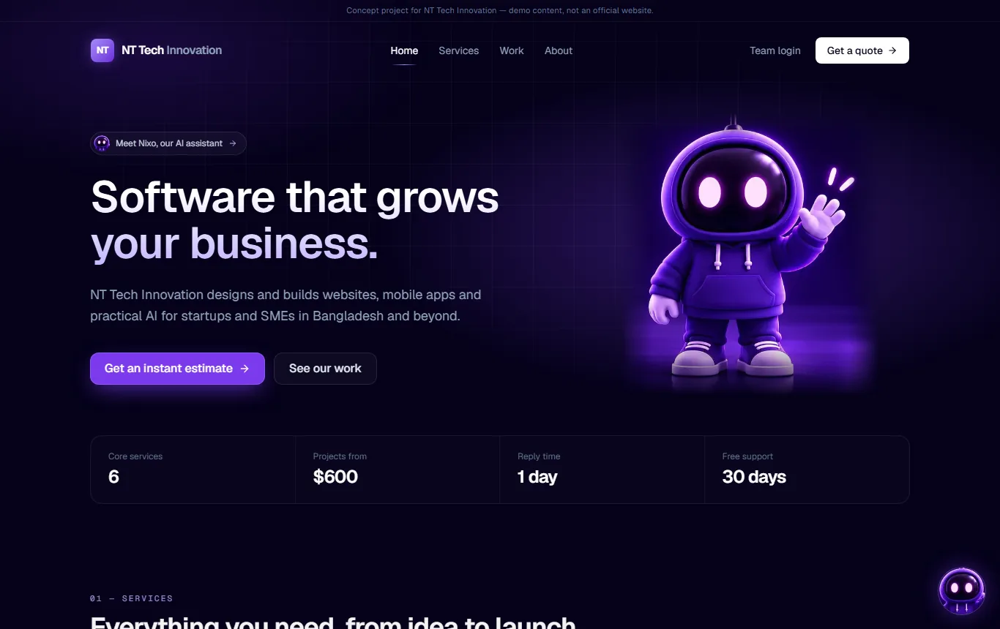

1. **Menu bar** (top): links to *Home*, *Services*, *Work* and *About*. **Team login** takes staff to the dashboard. **Get a quote** opens the price estimate form.
2. **Meet Nixo** button: opens the chat assistant.
3. **Get an instant estimate**: the quickest way to see a price.
4. **Key facts** under the main heading: number of services, starting price, reply time and free support period.

Scroll down to see the full page. Each section slides in gently as you reach it.

<details>
<summary>Show the full home page</summary>

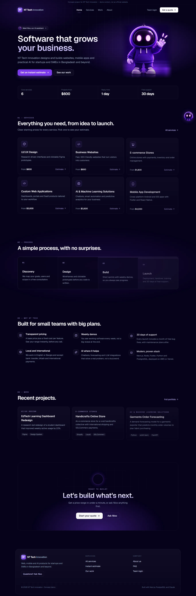

The sections, from top to bottom:
- **Services**: each card shows a starting price. Click a card to get an estimate for that service.
- **Process**: the four steps every project follows.
- **Why NT Tech**: the main reasons to choose the company.
- **Recent projects**: examples of past work.
- **Let's build what's next**: buttons to start a quote or ask Nixo.
- **Footer**: links to every page.

</details>

### 2.2 Services, Work and About

**Services** lists everything the company offers, with clear pricing:

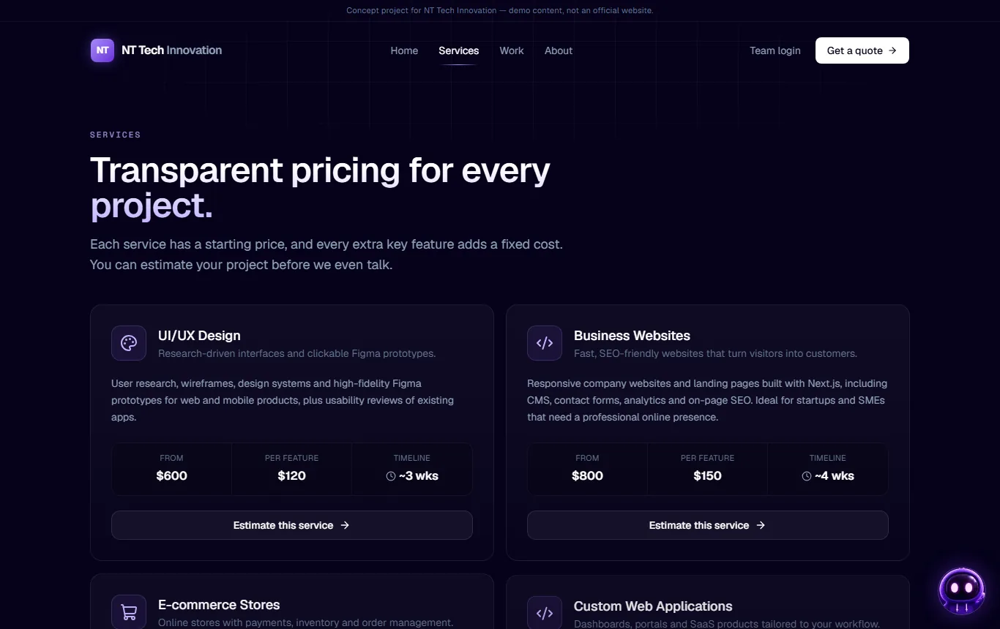

Each card shows:
- **From**: the starting price
- **Per feature**: the extra cost for each additional key feature
- **Timeline**: the usual number of weeks

Click **Estimate this service** to open the quote form with that service already selected.

**Work** shows finished projects and the technology used:

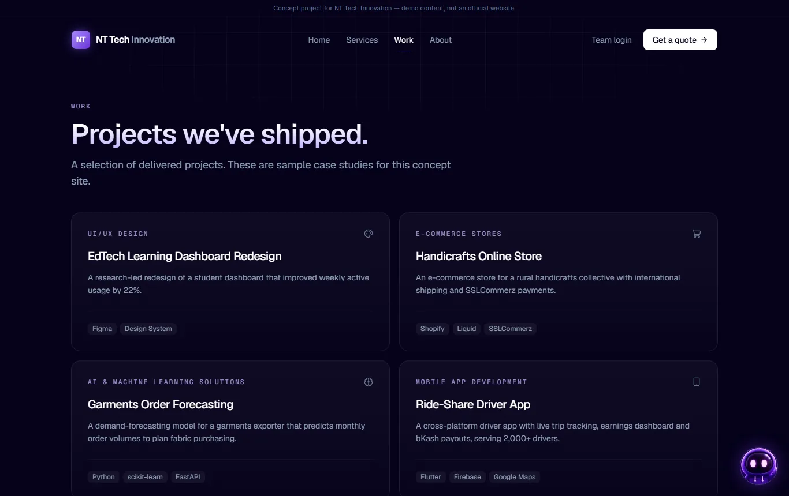

**About** introduces the team and answers common questions. Click a question to open or close its answer:

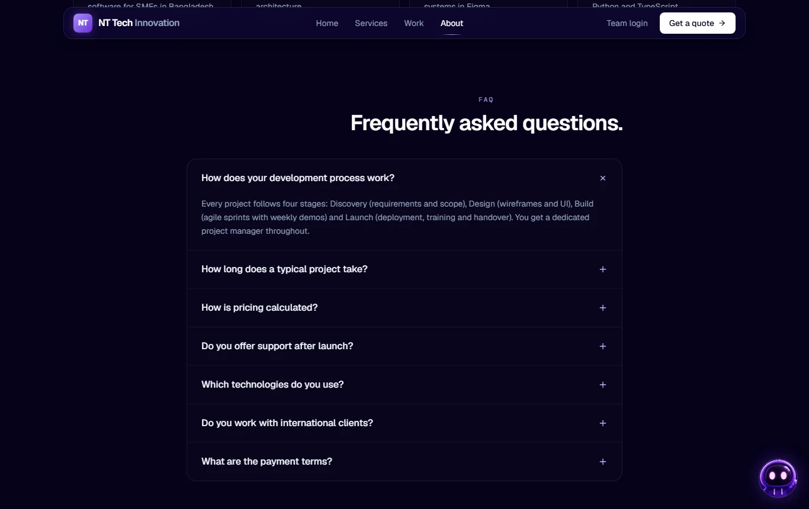

### 2.3 Chatting with Nixo

Nixo is the company's mascot and AI assistant. It answers questions using only the information on the website.

1. Click the round **Nixo** button in the bottom-right corner of any page.
2. Type a question, or click one of the suggested questions.

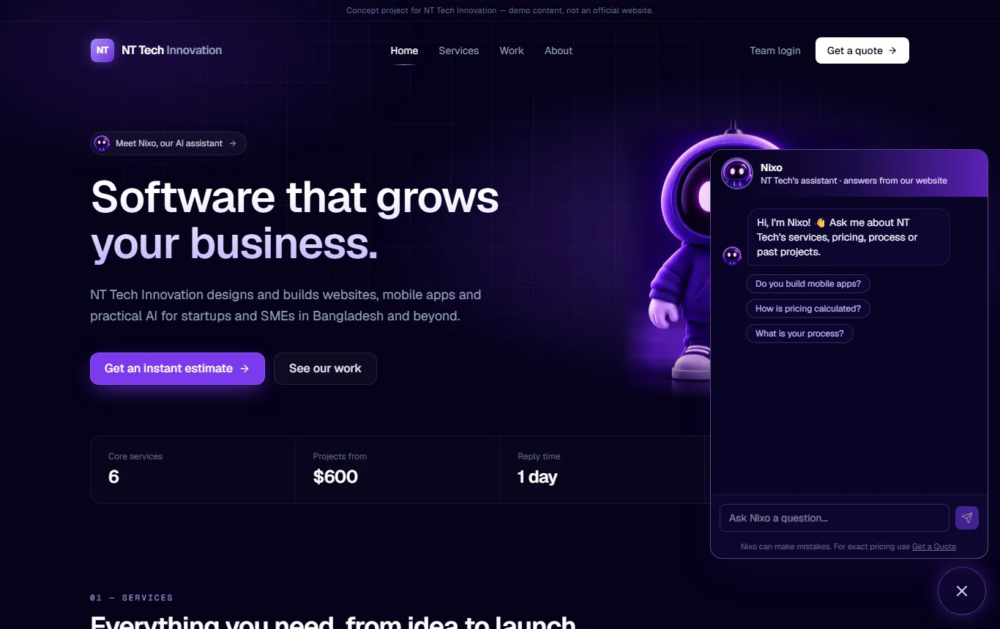

3. Nixo replies in a few seconds:

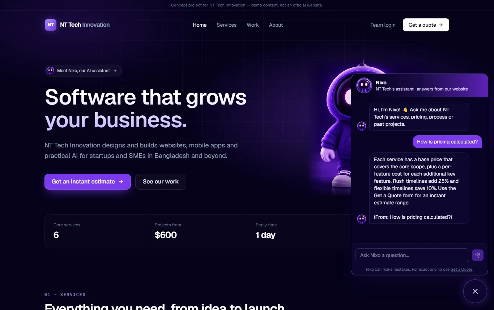

Good to know:
- Nixo answers questions about services, prices, the process and past projects.
- It politely declines unrelated questions (homework, general trivia and so on).
- For an exact price, use **Get a quote**.
- Click the **✕** button to close the chat.

### 2.4 Getting a quote

This is how a customer sends a project request. You will see a price range **instantly**, before sending anything.

1. Click **Get a quote** (top-right).

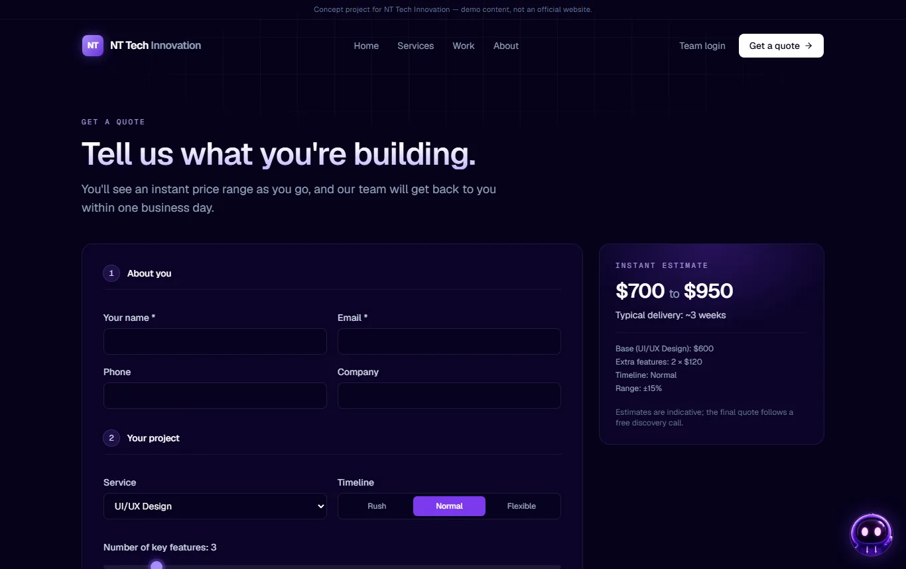

2. Fill in **Step 1 — About you**: your name and email are required; phone and company are optional.
3. Fill in **Step 2 — Your project**:
   - **Service**: pick one, or choose *Not sure yet*.
   - **Timeline**: *Rush* (+25%), *Normal*, or *Flexible* (−10%).
   - **Number of key features**: drag the slider. Examples of features: login, payments, admin dashboard, chat, search.
   - **Budget**: optional.
   - **Tell us about your project**: at least 20 characters. Describe what you want to build, who it is for and when you need it.
4. Watch the **Instant estimate** box on the right update as you change things. It also shows how the price was worked out.

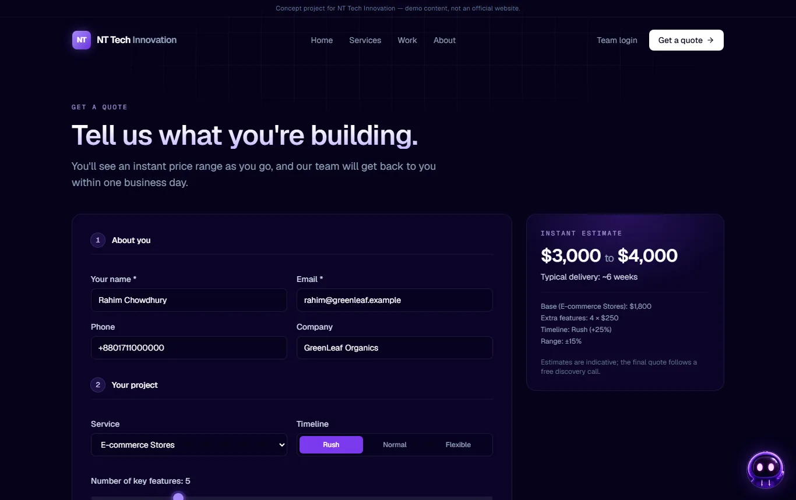

5. Click **Send request**. A confirmation appears with your estimate:

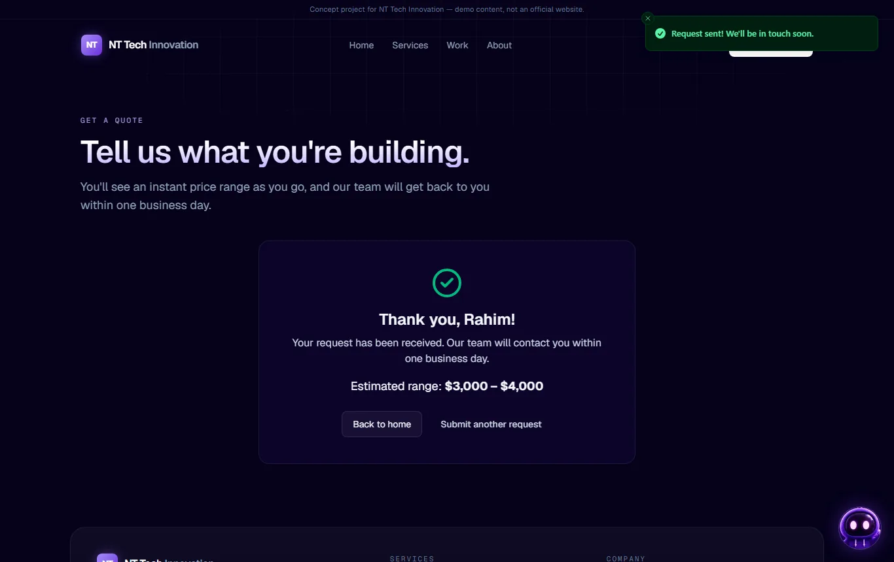

> **If something is wrong** (for example an invalid email), the field turns red and a message underneath tells you how to fix it.

Behind the scenes, the request appears in the team dashboard straight away, already sorted and scored by Nixo (see [3.4](#34-working-on-a-lead)).

### 2.5 On a phone

The website works on phones and tablets. The menu folds into the **☰** button at the top-right; tap it to open the links.

| Home on a phone | Menu opened |
|---|---|
| 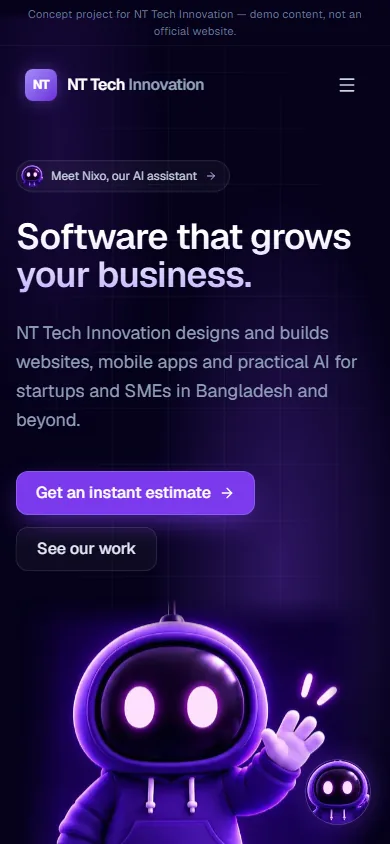 | 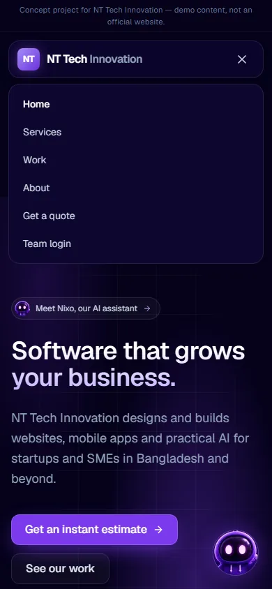 |

---

## 3. The team dashboard

The dashboard (also called the **CRM**) is where the agency team handles customer requests. You need an account to use it.

### 3.1 Logging in

1. Click **Team login** in the website menu, or go to `/login`.
2. Enter your email and password and click **Sign in**.

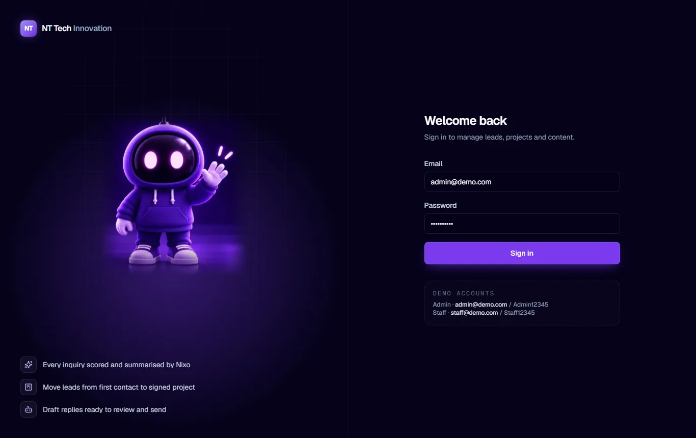

**Demo accounts** (also shown on the login page):

| Role | Email | Password |
|---|---|---|
| Admin | `admin@demo.com` | `Admin12345` |
| Staff | `staff@demo.com` | `Staff12345` |

To log out, click the **door icon** next to your name at the bottom of the left sidebar. You are also logged out automatically after 8 hours.

If you open the login page while you are still logged in, it says **You're signed in as …** instead of showing the form. Click **Continue to dashboard** to carry on, or **Sign out to use another account** to log in as someone else.

### 3.2 Dashboard

The first page after logging in gives a summary of the sales pipeline.

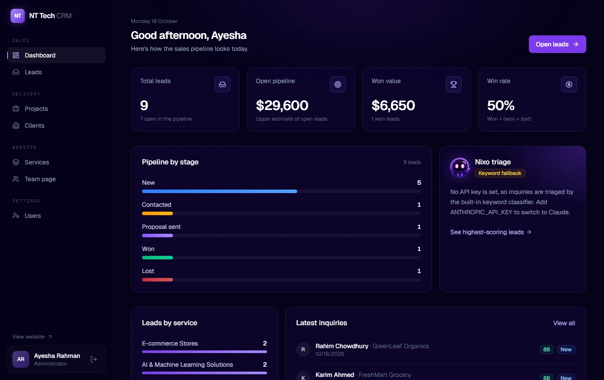

- **Left sidebar**: the main menu, in groups.
  - *Sales*: Dashboard, Leads
  - *Delivery*: Projects, Clients
  - *Website*: Services, Team page
  - *Settings*: Users (admins only)
- **Four summary cards**:
  - **Total leads**: every request received.
  - **Open pipeline**: the value of requests still in progress.
  - **Won value**: the value of requests that became paid projects.
  - **Win rate**: the percentage of finished requests that were won.
- **Pipeline by stage**: how many leads are at each step. Click a stage to see those leads.
- **Nixo triage**: shows whether the AI is using Claude or the built-in keyword system.
- **Leads by service**: which services people ask about most.
- **Latest inquiries**: the newest requests. Click one to open it.

### 3.3 Leads list and board

A **lead** is one customer request (from the quote form). Click **Leads** in the sidebar.

**Table view** (the default) lists every lead, with the most promising first:

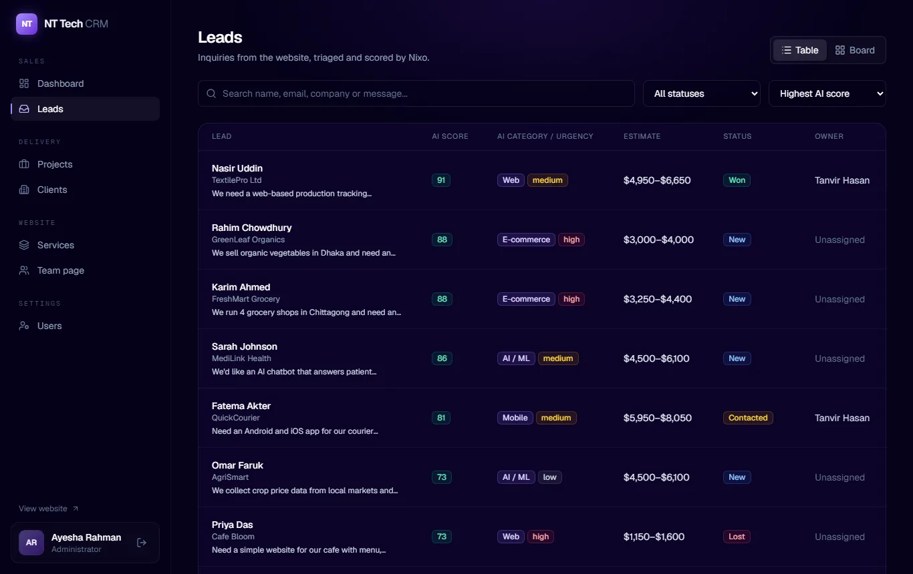

- **AI score**: Nixo's 0–100 guess at how promising the lead is. Green is strong, amber is fair, red is weak.
- **AI category / urgency**: what kind of project it is, and how soon it's needed.
- **Estimate**: the price range the customer was shown.
- **Status**: where the lead is in the pipeline.
- **Owner**: the team member responsible for it.

Use the **search box** to find a lead by name, email, company or message. Use the two drop-downs to **filter by status** or **sort** (highest score or newest). Use **Previous / Next** at the bottom to move between pages. Click any row to open the lead.

**Board view**: click **Board** (top-right) to see leads as columns, one per stage:

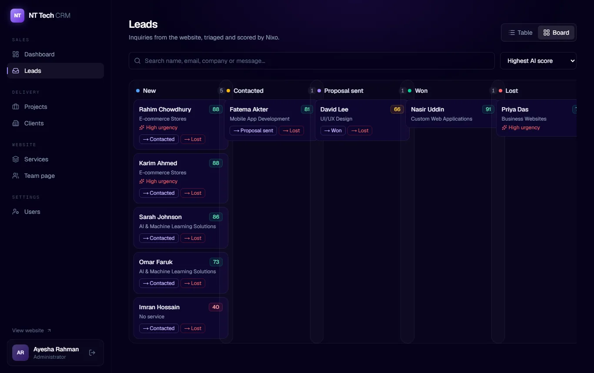

Each card has small **→ buttons** to move the lead to its next stage in one click.

### 3.4 Working on a lead

Click a lead to open its page.

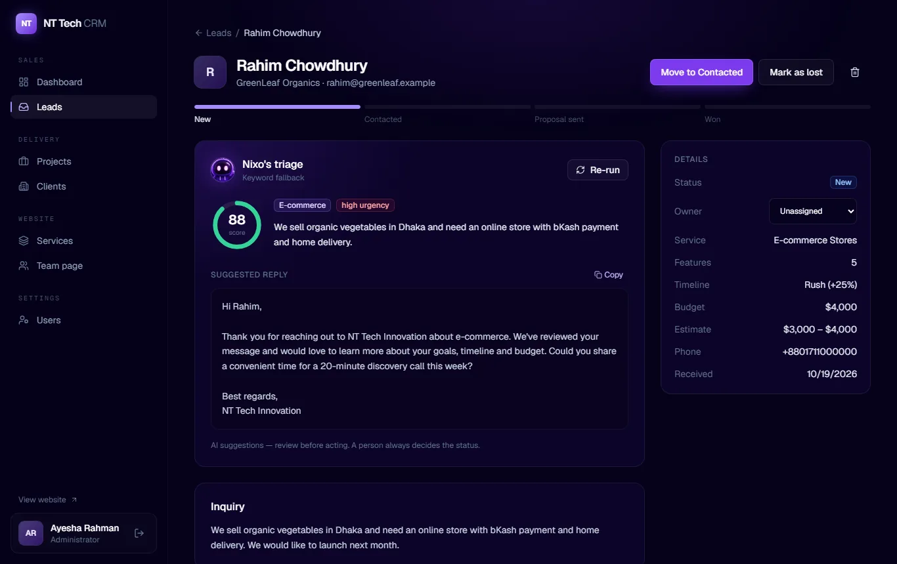

**At the top**
- The customer's name, company and email (click the email to write to them).
- **Action buttons** for the next step, e.g. **Move to Contacted** or **Mark as lost**.
- The **progress bar** shows how far the lead has come: *New → Contacted → Proposal sent → Won*.

**Nixo's triage** (the AI's analysis)
- The **score ring** (0–100).
- **Category** and **urgency** tags.
- A one-line **summary** of the request.
- A **suggested reply** email. Click **Copy** and paste it into your email program, then edit it before sending.
- **Re-run** asks the AI to analyse the lead again.

> The AI only *suggests*. A person always decides what happens to a lead.

**Details panel** (right): status, **Owner** (pick a team member from the drop-down to assign the lead), service, number of features, timeline, budget, estimate, phone and date received.

**Moving a lead to the next stage**

1. Click the action button, e.g. **Move to Contacted**.
2. A box opens where you can add an optional note (e.g. a call summary).
3. Click **Confirm**.

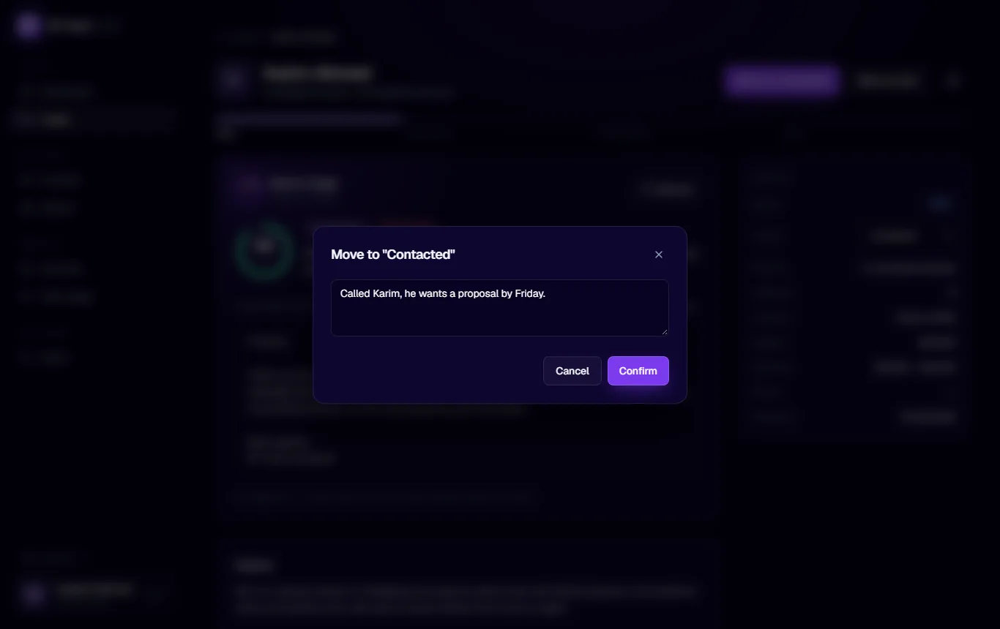

The pipeline only allows sensible steps:

```
New ──► Contacted ──► Proposal sent ──► Won
 │          │               │
 └──────────┴───────────────┴─────────► Lost
```

You can't skip from *New* straight to *Won*, and once a lead is *Won* or *Lost* it is closed.

**Notes and history**: scroll down to **Activity**. Type in the box and click **Add note** to record anything, e.g. a phone call. Everything that happens to the lead is listed below, newest first: who did it, and when.

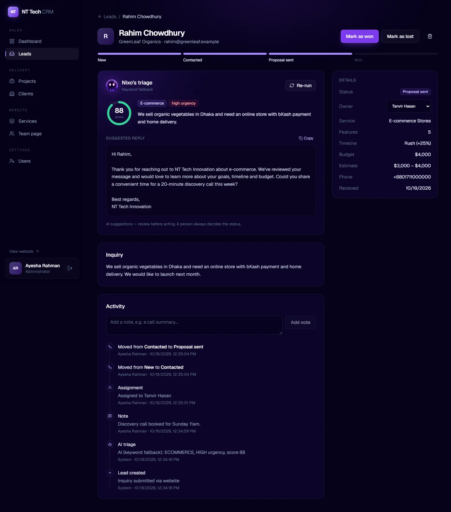

### 3.5 Winning a lead

When a customer agrees to go ahead, open their lead (it must be at *Proposal sent*) and click **Mark as won**, then **Confirm**.

The system then **automatically**:
- creates a **client** record for the customer;
- creates a **project** with four starting milestones: Discovery, Design, Build and Launch.

A green banner appears with a link to the new project:

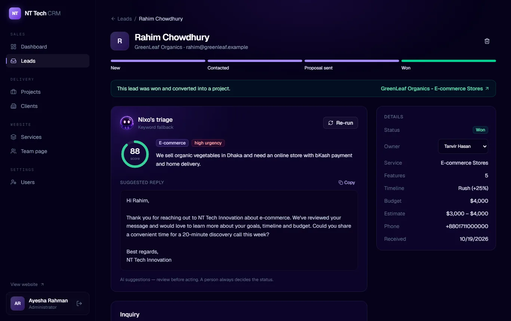

### 3.6 Projects and milestones

Click **Projects** in the sidebar to see every project and its progress:

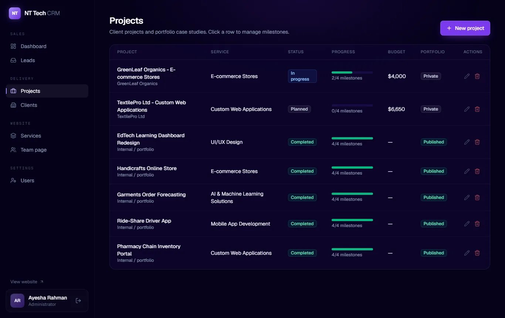

Click a project to open it:

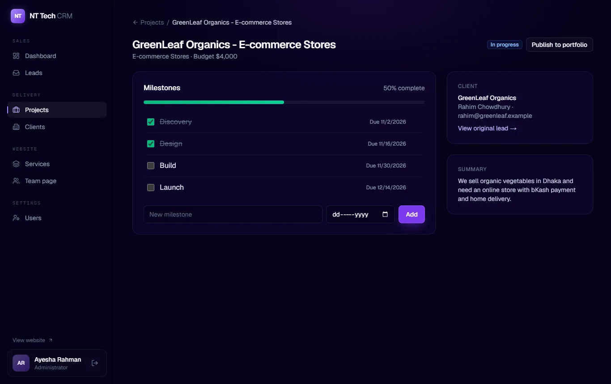

- **Tick a milestone** when it's finished. The progress bar and the project status update by themselves:
  - no milestones done → *Planned*
  - some done → *In progress*
  - all done → *Completed*
- **Add a milestone**: type a name, optionally pick a due date, and click **Add**.
- **Delete a milestone**: hover over it and click the red bin icon.
- **Publish to portfolio** shows the project on the public *Work* page. Click **Unpublish** to hide it again.
- The **Client** box links back to the original lead.

To edit a project's details (title, summary, technologies, budget and so on), go back to the list and click the **pencil icon** on its row.

### 3.7 Clients

**Clients** lists every customer. Most are created automatically when a lead is won (marked *Won lead*), but you can add one by hand with **New client**.

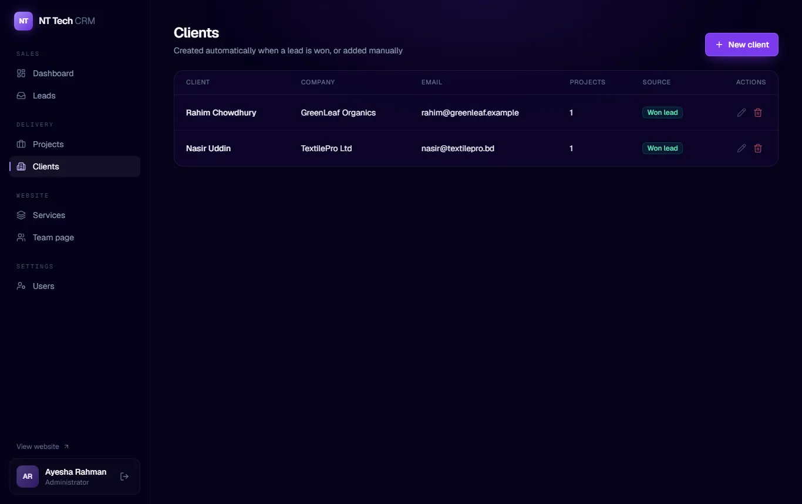

### 3.8 Services, team page and users

These screens all work the same way:
- **New …** (top-right) to add
- the **pencil icon** to edit
- the **bin icon** to delete (admins only)

**Services** controls the services and prices shown on the website and used by the quote calculator:

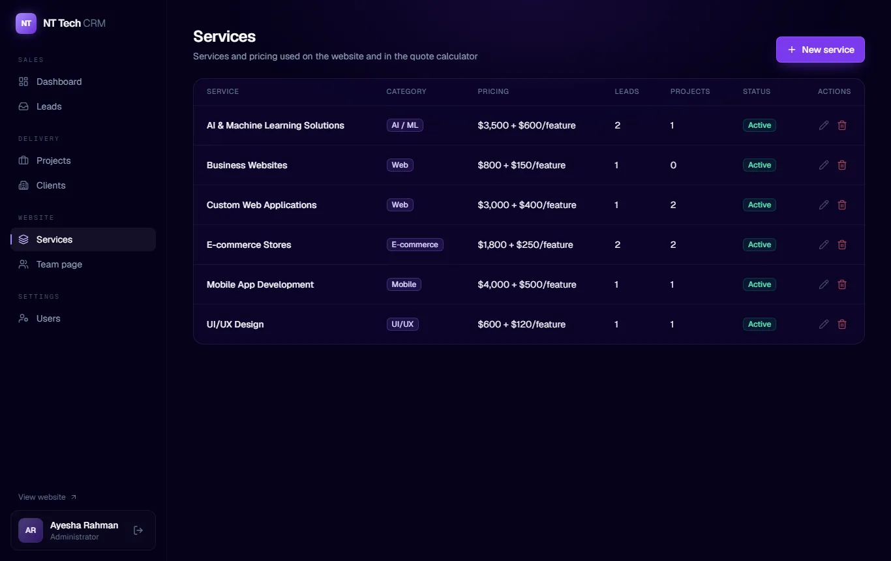

Click the pencil to edit a service. Changing prices here changes the website's estimates immediately. Untick **Active** to hide a service from the website without deleting it.

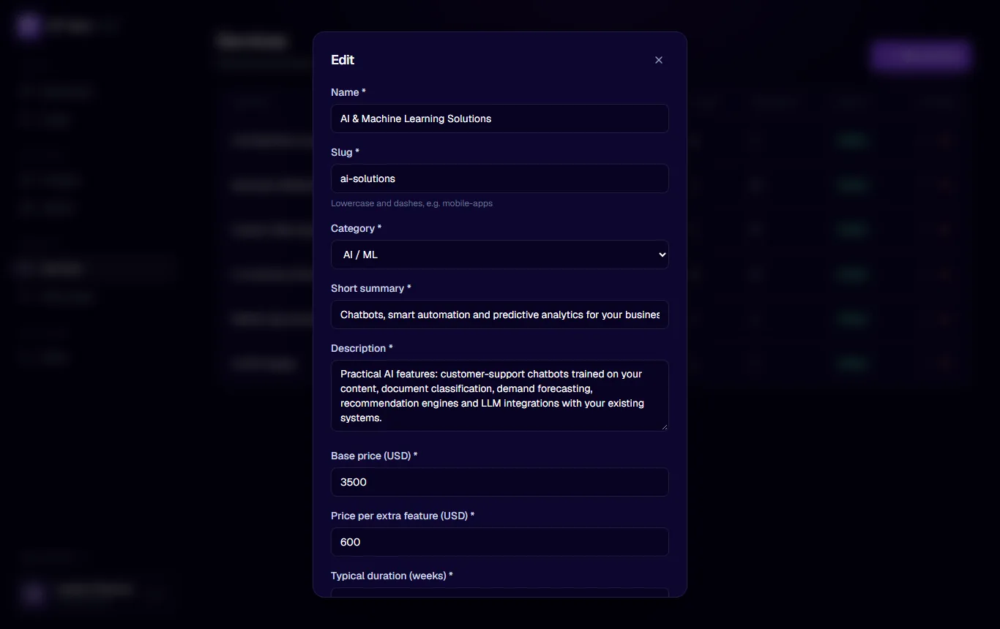

**Team page** controls the people shown on the public *About* page. **Display order** decides who appears first (0 = first).

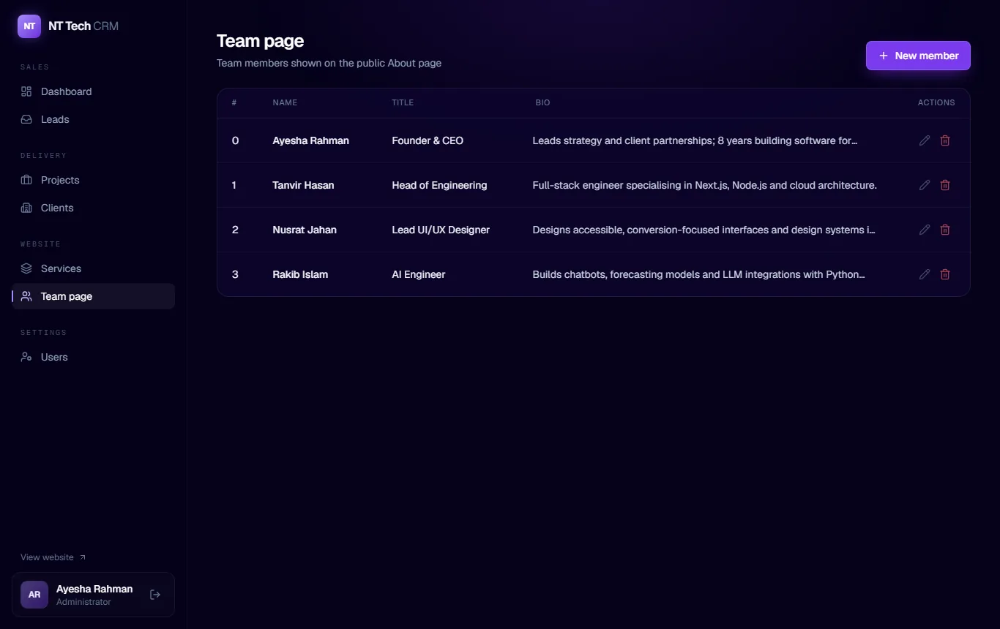

**Users** (admins only) manages who can log in to the dashboard. When creating a user, choose a role:
- **Staff**: can manage leads and content.
- **Admin**: full access, including users and deleting records.

Passwords need at least 8 characters, with at least one letter and one number.

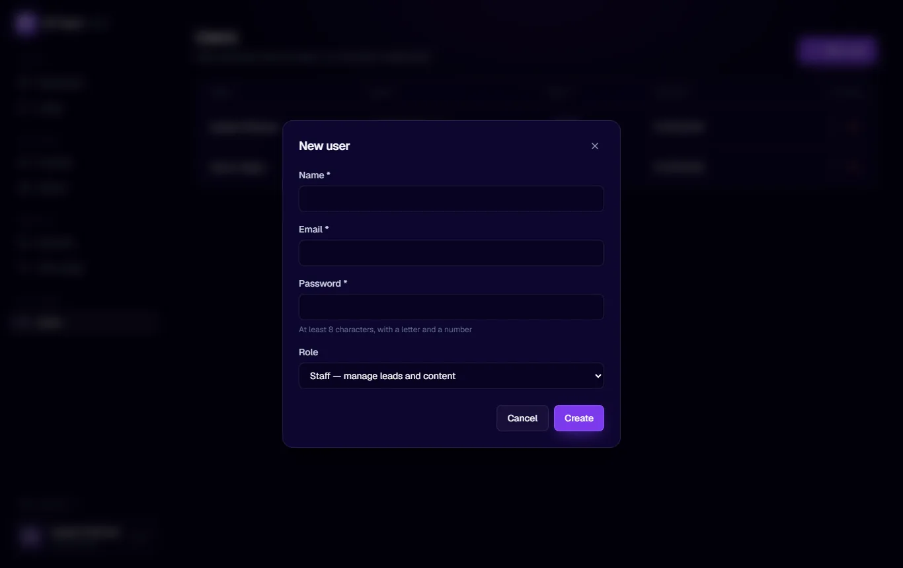

---

## 4. Staff vs admin

| Task | Staff | Admin |
|---|:---:|:---:|
| View the dashboard, leads, projects and clients | ✅ | ✅ |
| Move leads through the pipeline, add notes, assign owners | ✅ | ✅ |
| Re-run Nixo's AI analysis | ✅ | ✅ |
| Add and edit services, team members, clients and projects | ✅ | ✅ |
| Delete anything (leads, services, projects…) | ❌ | ✅ |
| Manage users (the **Users** menu) | ❌ | ✅ |

A staff member's sidebar has no **Users** item, and there are no delete buttons:

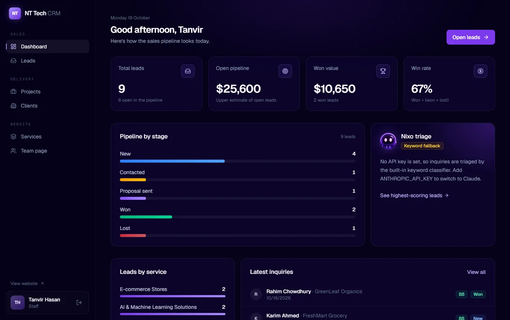

---

## 5. A complete example

Here is the journey this manual followed, from a customer's first visit to a running project:

1. **Rahim** (a customer) opens the website and asks Nixo *"How is pricing calculated?"* ([2.3](#23-chatting-with-nixo)).
2. He fills in **Get a quote** for an e-commerce store, sees **$3,000 – $4,000**, and sends the request ([2.4](#24-getting-a-quote)).
3. Within seconds his request appears on the **Dashboard** and in **Leads**, scored **88** (strong) by Nixo ([3.2](#32-dashboard), [3.3](#33-leads-list-and-board)).
4. The admin opens the lead, assigns it to **Tanvir**, copies Nixo's suggested reply, and adds a note after the first call ([3.4](#34-working-on-a-lead)).
5. The lead moves **New → Contacted → Proposal sent**.
6. Rahim agrees, so the lead is **marked as won**. A client and a project are created automatically ([3.5](#35-winning-a-lead)).
7. The team ticks off **Discovery** and **Design** as work progresses, and the project shows *In progress* at 50% ([3.6](#36-projects-and-milestones)).
8. When it's finished, they tick the last milestones and click **Publish to portfolio**, so it appears on the public *Work* page.

---

## 6. Troubleshooting

| Problem | What to do |
|---|---|
| The page says it can't connect, or shows "Something went wrong" | The database is probably not running. Start **Docker Desktop**, then run `docker compose up -d`. |
| "Invalid email or password" | Check for typos. If you are using the demo, run `npm run db:seed` to recreate the demo accounts (this also resets the demo data). |
| "Too many requests. Try again in …s" | The app limits rapid repeated actions (e.g. many logins or quote requests) to stop abuse. Wait the number of seconds shown. |
| I was sent back to the login page | Your session expired (after 8 hours) or your account was changed. Log in again. |
| A button says I don't have permission | That action is for admins only (see [Part 4](#4-staff-vs-admin)). |
| "Cannot move a lead from … to …" | The pipeline only allows the steps shown in [3.4](#34-working-on-a-lead). Move the lead through the stages in order. |
| The estimate box says it couldn't load | You can still send the request. Refresh the page; if it continues, check the app is running. |
| Nixo's answers seem basic | Without an API key Nixo uses the built-in keyword system. Add `ANTHROPIC_API_KEY` to `.env` and restart (see [Part 1](#1-getting-started)). |
| Pages look broken or unstyled after updating the code | Stop the app, delete the `.next` folder, and run `npm run dev` again. |
| Port 3000 is already in use | Another copy of the app is still running. Close that copy first (press **Ctrl + C** in its terminal). Don't start a second copy on another port: both would share the `.next` folder and break each other. |
| The first visit to a page, or the first sign-in, takes a few seconds | Normal for `npm run dev`: each page is prepared the first time you open it, then it is fast. For a quick, realistic demo run `npm run preview` instead (it builds the app once, then every page opens instantly). |
| Clicking **Team login** shows "too many redirects" | Fixed in the current version. On an older copy, clear the site's cookies for `localhost` (or use a private window) and log in again. |

---

## 7. Glossary

| Word | Meaning |
|---|---|
| **Lead** | A request from a possible customer, sent through the quote form. |
| **Pipeline** | The stages a lead moves through: New → Contacted → Proposal sent → Won / Lost. |
| **Triage** | Nixo's automatic first look at a lead: category, urgency, score, summary and draft reply. |
| **Score** | A 0–100 estimate of how promising a lead is. |
| **Owner** | The team member responsible for following up a lead. |
| **Client** | A customer who has agreed to work with the company. |
| **Project** | The work being delivered for a client, tracked with milestones. |
| **Milestone** | One step of a project (e.g. Design). Ticking milestones updates the project's progress. |
| **Portfolio** | Finished projects shown publicly on the *Work* page. |
| **Admin / Staff** | The two types of team account (see [Part 4](#4-staff-vs-admin)). |
| **Seed** | The command `npm run db:seed`, which resets the app to its demo data. |
